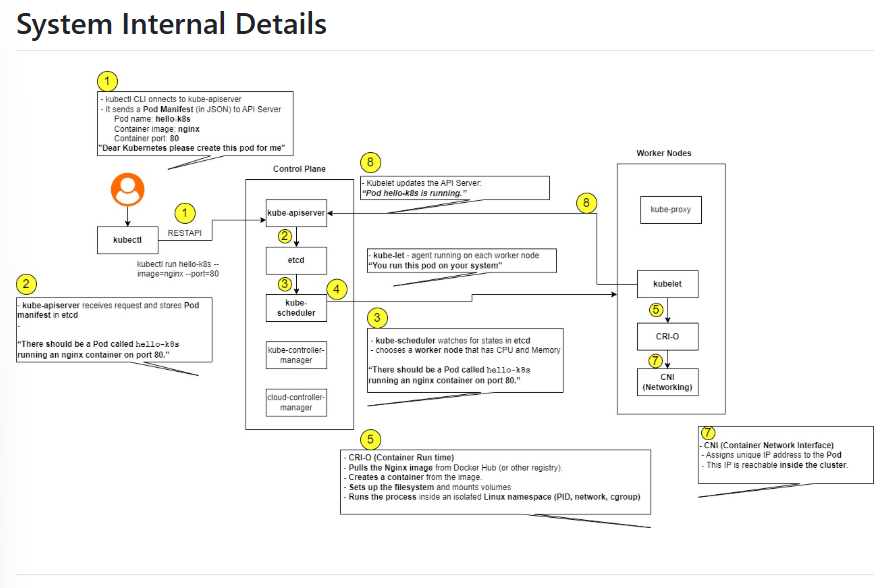

# Kubernetes Hands-On Exercise Series

Welcome to **Exercise 1: Hello Pod** of the Kubernetes (K8s) exercises!  
These hands-on activities demonstrate how Kubernetes schedules, runs, and manages containerized applications in production environments.

---

## 🏬 Business Problem (Zepto Example)

Imagine you are a **DevOps Engineer at Zepto**.  
The product team just built a lightweight **web app** that shows the **storefront and delivery status page** for customers.

### Your DevOps Mission:
- **Deploy this app on Kubernetes** so that it is always running, resilient, and can be scaled horizontally later.
- Simulate this application using the official `nginx` container image (representing Zepto's storefront and delivery tracking web app).
- Expose the app so customers and internal stakeholders can access it via a web browser.

---

## 🎯 Exercise 1: Hello Pod

**Goal:** Run your first application inside a Kubernetes cluster and access it externally.

---

## 📋 Pre-Requisites

### 1. Install Minikube & Kubectl (One-Time Setup)

- **Linux:**
  ```bash
  curl -LO https://storage.googleapis.com/minikube/releases/latest/minikube-linux-amd64
  sudo install minikube-linux-amd64 /usr/local/bin/minikube
  ```

- **macOS (via Homebrew):**
  ```bash
  brew install minikube
  ```

- **Windows (PowerShell / Admin):**
  ```powershell
  choco install minikube
  # Or using winget:
  winget install Kubernetes.minikube
  ```

- **WSL (Windows Subsystem for Linux):**
  ```bash
  # Update package repositories
  sudo apt-get update -y
  sudo apt-get install -y curl apt-transport-https virtualbox virtualbox-ext-pack

  # Download and install Minikube binary
  curl -LO https://storage.googleapis.com/minikube/releases/latest/minikube-linux-amd64
  sudo install minikube-linux-amd64 /usr/local/bin/minikube
  ```

> **Note:** A container runtime or VM driver (such as **Docker Desktop**, **VirtualBox**, or **Hyper-V**) must be running.

---

## 🚀 Step-by-Step Instructions

### Approach A: Imperative Commands (CLI)

#### Step 1: Start your local Kubernetes cluster
```bash
minikube start
```

#### Step 2: Create your first Pod (using the Nginx image)
```bash
kubectl run hello-k8s --image=nginx --port=80
```

#### Step 3: Verify the Pod is running
```bash
kubectl get pods
```
*Expected Output:*
```text
NAME        READY   STATUS    RESTARTS   AGE
hello-k8s   1/1     Running   0          15s
```

#### Step 4: Expose the Pod as a Service
```bash
kubectl expose pod hello-k8s --type=NodePort --port=80
```
*Expected Output:*
```text
service/hello-k8s exposed
```

#### Step 5: Open the app in your browser
```bash
minikube service hello-k8s
```
This automatically opens your default browser and displays the Nginx welcome page, confirming your containerized Zepto storefront is live and serving traffic.

---

### Approach B: Declarative Manifests (Infrastructure as Code)

In production DevOps workflows, resources are managed declaratively using YAML manifests.

#### 1. Pod Manifest (`pod.yaml`)
```yaml
apiVersion: v1
kind: Pod
metadata:
  name: hello-k8s
  labels:
    app: hello-k8s
    tier: frontend
    service: zepto-storefront
spec:
  containers:
  - name: hello-k8s
    image: nginx:alpine
    ports:
    - containerPort: 80
      name: http
    resources:
      requests:
        memory: "64Mi"
        cpu: "50m"
      limits:
        memory: "128Mi"
        cpu: "100m"
```

#### 2. Service Manifest (`service.yaml`)
```yaml
apiVersion: v1
kind: Service
metadata:
  name: hello-k8s
  labels:
    app: hello-k8s
spec:
  type: NodePort
  selector:
    app: hello-k8s
  ports:
  - name: http
    port: 80
    targetPort: 80
    protocol: TCP
```

#### 3. Deploy using YAML manifests:
```bash
kubectl apply -f pod.yaml
kubectl apply -f service.yaml
```

---

## 🔍 System Internal Details

<p align="center">
  
</p>

### What happens under the hood when you run `kubectl run hello-k8s`?

| Step | Component | Action |
|:---:|:---|:---|
| **1** | **`kubectl` &rarr; `kube-apiserver`** | The `kubectl` CLI converts your command into a Pod manifest (JSON) and sends an HTTP POST REST request to `kube-apiserver`: *"Please create a pod named `hello-k8s` running container image `nginx` on port `80`."* |
| **2** | **`kube-apiserver` &rarr; `etcd`** | `kube-apiserver` authenticates, authorizes, and validates the request, then stores the desired Pod state reliably in `etcd` (the distributed key-value store). |
| **3** | **`kube-scheduler`** | `kube-scheduler` watches `etcd` (via `kube-apiserver`) for unscheduled pods (pods without a `nodeName`). It evaluates available worker nodes based on CPU, memory, taints/tolerations, and selects the most optimal worker node. |
| **4** | **`kube-scheduler` &rarr; `kube-apiserver`** | The scheduler binds the pod to the selected worker node and writes this assignment back to `etcd` through `kube-apiserver`. |
| **5** | **`kubelet` &rarr; Container Runtime (CRI-O / containerd / Docker)** | The `kubelet` agent running on the assigned worker node discovers the new pod assignment via `kube-apiserver`. It instructs the container runtime interface (CRI) to pull the Nginx image from Docker Hub, create the container filesystem, mount volumes, and run the process inside an isolated Linux namespace (PID, mount, network, cgroup). |
| **6** | **CNI (Container Network Interface)** | The CNI plugin assigns a unique, cluster-routable IP address to the Pod and connects its network namespace to the node bridge. |
| **7** | **`kube-proxy`** | Programs packet forwarding and iptables/IPVS rules on worker nodes so traffic routed to the NodePort reaches the Pod. |
| **8** | **`kubelet` &rarr; `kube-apiserver`** | `kubelet` monitors the container status and reports back to `kube-apiserver` that `hello-k8s` is running. The API server updates `etcd`, which `kubectl get pods` subsequently reads. |

---

## 🧪 Verification & Inspection

Inspect your running Pod and Service with these essential Kubernetes commands:

```bash
# Check Pod status and assigned IP
kubectl get pods -o wide

# Inspect detailed Pod lifecycle events and configurations
kubectl describe pod hello-k8s

# Check container output logs
kubectl logs hello-k8s

# Check service endpoint mappings
kubectl get endpoints hello-k8s
```

---

## 🧹 Cleanup

When finished testing, clean up the created resources:

```bash
# Remove the Service
kubectl delete service hello-k8s

# Remove the Pod
kubectl delete pod hello-k8s
```

Or run the provided script:
- Linux / macOS / WSL: `./cleanup.sh`
- Windows PowerShell: `.\cleanup.ps1`
